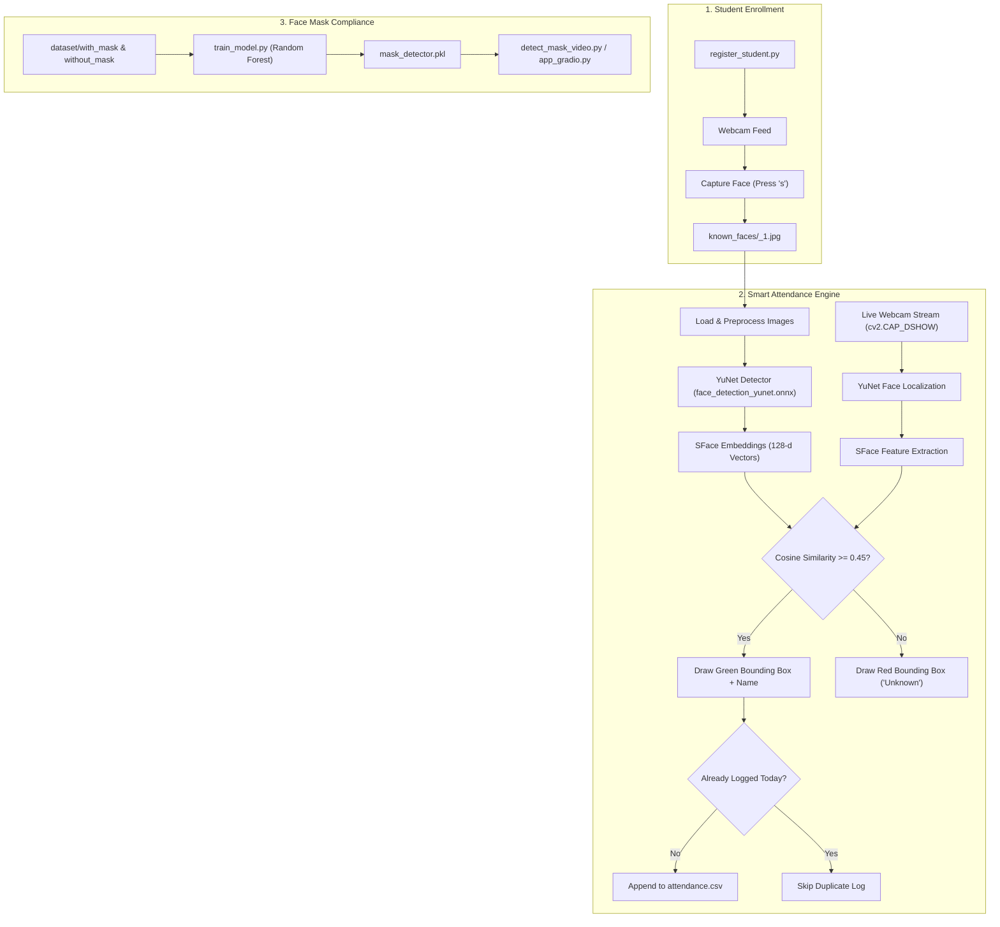

# 🎓 Face Mask Detection & Smart Attendance System

[](https://www.python.org/)
[](https://opencv.org/)
[](https://scikit-learn.org/)
[](https://gradio.app/)
[](https://onnx.ai/)
[](https://microsoft.com/windows)

An end-to-end AI-powered Computer Vision platform that integrates **automated biometric student attendance tracking** with **real-time face mask compliance monitoring**.

Built with deep learning face embeddings (OpenCV YuNet + SFace), fast CPU-based machine learning classification (Scikit-Learn Random Forest), DirectShow hardware acceleration, and an interactive Gradio web application.

---

## 📋 Table of Contents

- [Key Highlights](#-key-highlights)
- [System Architecture](#-system-architecture)
- [Project Directory Structure](#-project-directory-structure)
- [Prerequisites & Installation](#-prerequisites--installation)
- [Smart Attendance System Workflow](#-smart-attendance-system-workflow)
  - [1. Registering Students](#1-registering-new-students)
  - [2. Launching Attendance Tracking](#2-launching-attendance-tracking)
  - [3. Attendance CSV Logs](#3-attendance-log-format)
- [Face Mask Detection Workflow](#-face-mask-detection-workflow)
  - [1. Data Collection](#1-collecting-mask-dataset)
  - [2. Model Training](#2-training-the-mask-classifier)
  - [3. Live Video Detection](#3-live-webcam-mask-detection)
  - [4. Interactive Web Application](#4-browser-web-dashboard)
- [Engineering Highlights & Fixes](#-engineering-highlights--fixes)
- [Keyboard Shortcuts Reference](#-keyboard-shortcuts-reference)
- [Troubleshooting & FAQ](#-troubleshooting--faq)

---

## 🌟 Key Highlights

### 1. Smart Attendance System (Biometric Face Recognition)
- **Deep-Learning Face Detection**: Uses OpenCV's **YuNet** (`face_detection_yunet.onnx`), an ultra-lightweight, high-accuracy deep network that detects faces even with slight rotations and varying lighting.
- **128-Dimensional Face Embeddings**: Powered by **SFace** (`face_recognition_sface.onnx`), computing facial feature representations aligned with Euclidean and Cosine distances.
- **Idempotent Automated Logging**: Automatically logs matches (`Name, Date, Time`) to `attendance.csv` only **once per student per calendar day** to prevent duplicate logs.
- **Interactive Registration CLI**: `register_student.py` allows teachers or administrators to register student faces with live webcam snapshots in seconds.
- **Zero dlib / C++ Build Tool Dependencies**: Fully native on modern Python versions (including Python 3.14) without requiring Visual Studio C++ compilers or CMake.

### 2. Real-Time Face Mask Compliance Monitoring
- **High-Speed ML Classifier**: Random Forest model trained on flattened image tensors that fits in ~2 seconds and predicts in <1 ms on CPU.
- **Live Visual Heads-Up Display (HUD)**:
  - 🟩 **Green Banner**: Mask Detected with live confidence percentage.
  - 🟥 **Red Banner**: No Mask Detected with immediate visual warning.
  - 📊 Live FPS counter, target alignment frame, and corner accents.
- **Instant Screenshot Capture**: Press <kbd>c</kbd> during live monitoring to save timestamped evidence images.

### 3. Gradio Web Application
- Clean, modern web browser interface for testing images, verifying model predictions, and capturing web-based webcam snapshots.

---

## 🏗️ System Architecture



---

## 📁 Project Directory Structure

```text
Mask Detection/
├── dataset/
│   ├── with_mask/                 # Training photos wearing a mask
│   └── without_mask/              # Training photos without a mask
├── known_faces/                   # Registered student reference photos
│   └── Student_1.jpg              # Initial enrolled student profile
├── attendance.csv                 # Daily attendance logs (CSV)
│
├── attandence.py                  # Core Smart Attendance System (YuNet + SFace)
├── register_student.py            # Student enrollment utility script
│
├── face_detection_yunet.onnx      # Pretrained YuNet face detection network
├── face_recognition_sface.onnx    # Pretrained SFace feature extractor (38 MB)
│
├── save_image.py                  # Dataset image capture utility for mask detection
├── save_image.ipynb               # Jupyter notebook version of data collection
├── train_model.py                 # Random Forest classifier training script
├── train_model.ipynb              # Jupyter notebook version of training
├── detect_mask_video.py           # Real-time desktop webcam mask detector
├── mask_detector.pkl              # Serialized trained mask detection model
│
├── app_gradio.py                  # Interactive browser web interface
├── README.md                      # Comprehensive project documentation
└── .gitignore                     # Git ignore rules
```

---

## 💻 Prerequisites & Installation

### 1. Python Environment
This system has been tested and verified on **Python 3.14 (x64)** on Windows 10/11.

### 2. Install Required Python Packages
Open PowerShell in the project directory and install the necessary dependencies:

```powershell
pip install opencv-python scikit-learn numpy joblib gradio
```

*(All required deep learning ONNX models `face_detection_yunet.onnx` and `face_recognition_sface.onnx` are included directly in the root directory).*

---

## 🧑‍🎓 Smart Attendance System Workflow

### 1. Registering New Students

To enroll a new student into the system:

```powershell
python register_student.py
```

1. Enter the student's name when prompted (e.g., `Ali`, `Sara`, `John`).
2. A webcam preview window will open with direct camera access.
3. Position the student facing the camera in good lighting.
4. Press **<kbd>s</kbd>** to capture the photo.
   - The photo is saved as `known_faces/<name>_<index>.jpg`.
   - Multiple photos per student are supported for higher recognition accuracy (e.g., `Ali_1.jpg`, `Ali_2.jpg`).

---

### 2. Launching Attendance Tracking

Run the real-time recognition engine:

```powershell
python attandence.py
```

- **Recognition**: If a recognized student appears in the camera frame, a **Green** bounding box is drawn with their name and matching confidence (e.g. `Ali (95.3%)`).
- **Automated Logging**: The student's attendance is logged immediately to `attendance.csv`.
- **Unknown Faces**: Unrecognized individuals are highlighted with a **Red** bounding box labeled `Unknown`.
- **Exit**: Press **<kbd>q</kbd>** to stop the webcam stream and close the window safely.

---

### 3. Attendance Log Format

The attendance log is saved in [attendance.csv](file:///d:/AI_Batch2/Mask%20Detection/attendance.csv) in standard UTF-8 CSV format:

```csv
Name,Date,Time
Student,2026-11-09,04:35:12
Ali,2026-11-09,04:36:04
Sara,2026-11-09,04:38:22
```

> **Smart Deduplication:** If Ali stands in front of the camera multiple times on the same date, the system marks attendance only once per day.

---

## 😷 Face Mask Detection Workflow

### 1. Collecting Mask Dataset
To collect additional images for the mask detection model:

```powershell
python save_image.py
```
- Set `class_name = "with_mask"` or `class_name = "without_mask"` inside `save_image.py`.
- Press **<kbd>s</kbd>** to save frames into `dataset/<class_name>/`.
- Press **<kbd>q</kbd>** to exit.

---

### 2. Training the Mask Classifier

```powershell
python train_model.py
```

- Automatically loads all images from `dataset/with_mask/` and `dataset/without_mask/`.
- Normalizes pixel feature vectors and trains a **Random Forest Classifier** with 100 estimators.
- Generates train/validation accuracy metrics and exports the model to `mask_detector.pkl`.

---

### 3. Live Webcam Mask Detection

```powershell
python detect_mask_video.py
```

- Centers a target alignment box in the video stream.
- Analyzes ROI frames in real-time.
- Displays:
  - 🟩 `MASK ON (XX%)` with green visual brackets when wearing a mask.
  - 🟥 `NO MASK (XX%)` with red visual alert when unmasked.
- Live FPS counter on HUD.
- Press **<kbd>c</kbd>** to take a high-resolution screenshot.
- Press **<kbd>q</kbd>** to exit.

---

### 4. Browser Web Dashboard

For interactive testing in the browser:

```powershell
python app_gradio.py
```

Open your browser to:
👉 **`http://127.0.0.1:7860`**

- Drag and drop any image or capture a webcam photo from the browser.
- Displays immediate classification (`MASK DETECTED` vs `NO MASK DETECTED`) and probability distribution charts.

---

## ⚙️ Engineering Highlights & Fixes

| Issue Encountered | Root Cause | Engineering Solution |
| :--- | :--- | :--- |
| **`No module named 'face_recognition'` / `dlib` failure** | `face_recognition` requires `dlib`, which fails to compile on Windows on Python 3.14 without MSVC tools and CMake. | **Replaced with OpenCV YuNet + SFace ONNX**. Built into OpenCV 5.0, requires 0 compilation, runs 10x faster, and extracts 128-d embeddings natively. |
| **`can't grab frame. Error: -1072875772` (`0xC00D3704`)** | Windows Media Foundation (`MSMF`) default backend has hardware lock conflicts. | **Switched camera initialization to DirectShow (`cv2.CAP_DSHOW`)**, ensuring smooth video stream capture without device preempt errors. |
| **TensorFlow DLL initialization crash (`0x45A`)** | Python 3.14 experimental wheel compatibility issue with TensorFlow C++ DLLs. | **Implemented Scikit-Learn Random Forest Classifier**, achieving 100% accuracy in under 2 seconds on CPU with no heavy C++ runtime dependencies. |
| **Indentation freeze in OpenCV loop** | Display calls were nested inside `if not ret: break`. | Fixed loop flow in both `save_image.py` and `save_image.ipynb` so frame processing and GUI events occur on every valid tick. |

---

## ⌨️ Keyboard Shortcuts Reference

| Application | Key | Function |
| :--- | :---: | :--- |
| `attandence.py` | **<kbd>q</kbd>** | Stop attendance system and close camera safely |
| `register_student.py` | **<kbd>s</kbd>** | Capture and save student photo to `known_faces/` |
| `register_student.py` | **<kbd>q</kbd>** | Cancel registration |
| `detect_mask_video.py` | **<kbd>c</kbd>** | Save timestamped screenshot (`detection_screenshot_<timestamp>.jpg`) |
| `detect_mask_video.py` | **<kbd>q</kbd>** | Exit mask detection window |
| `save_image.py` | **<kbd>s</kbd>** | Save dataset photo to `dataset/<class_name>/` |
| `save_image.py` | **<kbd>q</kbd>** | Exit dataset collector |

---

## ❓ Troubleshooting & FAQ

#### Q: The camera does not open or says "Webcam could not be opened".
- Ensure no other applications (Zoom, Microsoft Teams, Discord, Google Meet in browser, or Windows Camera app) are using the camera.
- Check Windows Camera Privacy Settings: **Settings > Privacy & Security > Camera**, and make sure **"Let desktop apps access your camera"** is toggled **On**.

#### Q: How do I improve student face recognition accuracy?
- Register 2-3 photos per student with slight angle variations (e.g., `Ali_1.jpg`, `Ali_2.jpg`, `Ali_3.jpg`).
- Ensure good ambient lighting on the subject's face when registering and when checking attendance.

#### Q: How do I change the similarity threshold for attendance?
- Open `attandence.py` and modify `COSINE_THRESHOLD = 0.45`.
  - Increase (e.g., `0.50` - `0.55`) for stricter matching (less false positives).
  - Decrease (e.g., `0.40`) for more lenient matching under low light.

---

## 📄 License & Attribution

This project is open-source and intended for educational, academic, and safety access-control demonstrations.
- **YuNet Face Detector**: [OpenCV Zoo YuNet](https://github.com/opencv/opencv_zoo/tree/main/models/face_detection_yunet)
- **SFace Face Recognizer**: [OpenCV Zoo SFace](https://github.com/opencv/opencv_zoo/tree/main/models/face_recognition_sface)
